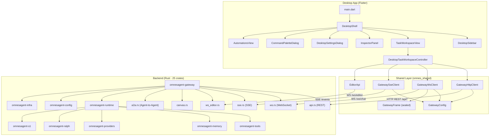

# 🔍 OmnesAgent ADE — Комплексный аудит десктопного приложения (ob2h)

> **Дата**: 2026-10-02 · **Метод**: ob2h AST-скан (66 файлов, 239 узлов, 180 связей, 9 988 строк)

---

## 📐 Архитектурная карта

---

## 🏗️ Структура приложения

### Backend: 25 Rust crates
| Crate | Назначение |
|-------|-----------|
| `omnesagent-gateway` | HTTP/WS/SSE сервер (axum), 43 файла, ~1.5M байт |
| `omnesagent-runtime` | Agent turn loop, tool execution, SOP runner |
| `omnesagent-tools` | Встроенные инструменты агента |
| `omnesagent-memory` | Семантическая память сессий |
| `omnesagent-providers` | LLM провайдеры (OpenAI, Anthropic, DeepSeek, etc.) |
| `omnesagent-config` | YAML/TOML конфигурация |
| `omnesagent-editor` | Серверный редактор кода (буфер, highlighting, folds) |
| `omnesagent-ralph` | Автономная инженерная петля (Ralph) |
| `omnesagent-s1` | System One (локальная модель) |
| `omnesagent-channels` | Telegram, Discord, Slack, WhatsApp каналы |
| `omnesagent-kag` | Knowledge-Augmented Generation |
| `omnesagent-infra` | SQLite сессии, персистенция |
| `omnesagent-eval` | Evaluation harness |
| `omnesagent-spawn` | Sub-agent spawn |
| `omnesagent-sop-graph` | SOP визуальные графы |
| Другие (10) | Plugins, macros, compression, TLS, hardware, etc. |

### Frontend: Desktop (Flutter)
| Модуль | Файлы | Назначение |
|--------|-------|-----------|
| [desktop_shell.dart](file:///c:/Projects/Omnes-agent/frontend/desktop/lib/features/desktop_shell.dart) | 630 строк | Верхнеуровневая оболочка: sidebar + workspace + inspector |
| [task_workspace_controller.dart](file:///c:/Projects/Omnes-agent/frontend/desktop/lib/features/workspace/task_workspace_controller.dart) | **2987 строк** | Главный контроллер: сессии, WS, SSE, терминал, Git |
| [task_workspace_view.dart](file:///c:/Projects/Omnes-agent/frontend/desktop/lib/features/workspace/task_workspace_view.dart) | — | UI чата, action steps, approval banners |
| [inspector_panel.dart](file:///c:/Projects/Omnes-agent/frontend/desktop/lib/features/inspector/inspector_panel.dart) | 83 KB | Канвас, редактор, файл-вьюер, браузер, артефакты |
| `inspector/` | 5 поддиректорий | trajectory, editor, side_chat, browser, artifacts |
| `settings/` | — | Настройки подключения, провайдеров, voice, etc. |
| `terminal/` | — | Встроенный терминал |
| `command_palette/` | — | Палитра команд (Ctrl+K) |
| `automations/` | — | Автоматизации/кроны |
| `onboarding/` | — | Первоначальная настройка |

### Shared Library (omnes_shared)
| Компонент | Файл | Назначение |
|-----------|------|-----------|
| [GatewayConfig](file:///c:/Projects/Omnes-agent/frontend/shared/lib/core/gateway/gateway_config.dart) | 137 строк | URL, токен, агент — единый источник конфигурации |
| [GatewayHttpClient](file:///c:/Projects/Omnes-agent/frontend/shared/lib/core/gateway/gateway_http.dart) | **2341 строк** | Все REST вызовы к бэкенду |
| [GatewayWsClient](file:///c:/Projects/Omnes-agent/frontend/shared/lib/core/gateway/gateway_ws.dart) | 199 строк | WebSocket клиент (стриминг, approval, abort) |
| [GatewaySseClient](file:///c:/Projects/Omnes-agent/frontend/shared/lib/core/gateway/gateway_sse.dart) | — | SSE для системных событий |
| [GatewayFrame](file:///c:/Projects/Omnes-agent/frontend/shared/lib/core/gateway/models/gateway_frame.dart) | 298 строк | **21 типов фреймов** (sealed class) |
| Дополнительные WS | canvas_ws, editor_ws, nodes_ws, sop_runs_ws | Специализированные WebSocket каналы |

---

## 🔗 Связи Frontend ↔ Backend

### 1. REST API (GatewayHttpClient → api.rs)
| Frontend метод | Backend endpoint | Назначение |
|---------------|-----------------|-----------|
| `checkHealth()` | `GET /health` | Проверка доступности gateway |
| `getStatus()` | `GET /api/status` | Системный статус |
| `getAgentAliases()` | `GET /api/config/map-keys?path=agents` | Список агентов |
| `getSessionsList()` | `GET /api/sessions` | Список сессий |
| `sendMessage()` | `POST /api/sessions/{id}/message` | Отправка через HTTP |
| + ещё ~80 методов | `/api/config/*`, `/api/memory/*`, `/api/tools/*`... | Полный REST API |

### 2. WebSocket (GatewayWsClient → ws.rs)
| Фронтенд действие | WS фрейм (client→server) | Описание |
|-------------------|-------------------------|----------|
| Отправка сообщения | `{"type": "message", "content": "..."}` | Запуск agent turn |
| Abort генерации | `{"type": "abort"}` | Прерывание |
| Подтверждение инструмента | `{"type": "approval_response", ...}` | HITL |
| Voice barge-in | `{"type": "voice_barge_in", ...}` | Прерывание TTS |

| WS фрейм (server→client) | Dart-тип | Описание |
|--------------------------|----------|----------|
| `chunk` / `agent_chunk` | `ChunkFrame` | Дельта ответа модели |
| `thinking` / `thinking_chunk` | `ThinkingFrame` | Chain-of-thought |
| `tool_call` | `ToolCallFrame` | Вызов инструмента агентом |
| `tool_result` | `ToolResultFrame` | Результат инструмента |
| `done` | `DoneFrame` | Завершение turn |
| `error` | `ErrorFrame` | Ошибка |
| `approval_request` | `ApprovalRequestFrame` | HITL запрос |
| `session_meta` | `SessionMetaFrame` | Метаданные сессии |
| `mode_changed` | `ModeChangedFrame` | Эскалация Chat→Task |
| `ralph_phase_progress` | `RalphProgressFrame` | Прогресс Ralph |
| `trajectory_step` | `TrajectoryStepFrame` | Шаг траектории |
| `context_budget_update` | `ContextBudgetFrame` | Бюджет контекста |
| `grounding_citation` | `GroundingCitationFrame` | Цитата из источника |
| `s1_event` | `S1EventFrame` | System One статус |
| `chunk_reset` | `ChunkResetFrame` | Сброс дельт |
| `aborted` | `AbortedFrame` | Генерация прервана |
| `connected` / `session_start` | `ConnectedFrame` | Handshake |
| `message` | `MessageFrame` | Полное сообщение |

### 3. SSE (GatewaySseClient → sse.rs)
- Глобальный поток системных событий
- Обработка: `session_created`, `session_deleted`, новые сообщения

### 4. Дополнительные WebSocket каналы
| Канал | Frontend | Backend | Назначение |
|-------|----------|---------|-----------|
| Editor WS | `editor_ws.dart` | `ws_editor.rs` | Совместное редактирование |
| Canvas WS | `canvas_ws.dart` | `canvas.rs` | Visual canvas |
| Nodes WS | `nodes_ws.dart` | `nodes.rs` | Node-based workflows |
| SOP Runs WS | `sop_runs_ws.dart` | `ws_sop_runs.rs` | SOP execution streaming |

---

## 🖥️ Функционал десктопного приложения

### Основные возможности
| # | Функция | Реализация | Состояние |
|---|---------|-----------|-----------|
| 1 | **Чат с агентом** | WS streaming + frame handler | ✅ Полная |
| 2 | **Мульти-сессии** | `TaskSession`, tab management | ✅ Полная |
| 3 | **Thinking / CoT** | `ThinkingFrame`, expand/collapse | ✅ Полная |
| 4 | **Tool calls UI** | `ToolCallFrame` → `AgentActionStep` | ✅ Полная |
| 5 | **Approval (HITL)** | `ApprovalRequestFrame` → баннер | ✅ Полная |
| 6 | **Встроенный терминал** | `Process.start()`, stdin/stdout | ✅ Полная |
| 7 | **Inspector Panel** | Канвас, редактор, файлы, браузер | ✅ Полная |
| 8 | **Настройки** | Dialog: gateway URL, token, voice | ✅ Полная |
| 9 | **Command Palette** | Ctrl+K → палитра команд | ✅ Полная |
| 10 | **Git интеграция** | Branch read, diff stats | ✅ Полная |
| 11 | **Context Budget Gauge** | `ContextBudgetFrame` → meter | ✅ Полная |
| 12 | **Trajectory Inspector** | `TrajectoryStep` timeline | ✅ Полная |
| 13 | **Mode Escalation** | Chat → Task → Ralph | ✅ Полная |
| 14 | **Ralph Progress** | Phase/step progress bar | ✅ Полная |
| 15 | **Side Chat** | Inspector sub-chat | ✅ Полная |
| 16 | **System Tray** | Minimize, new task, quit | ✅ Полная |
| 17 | **Todo Widget** | Парсинг TODO блоков из ответа | ✅ Полная |
| 18 | **Grounding Citations** | Source citations UI | ✅ Полная |
| 19 | **S1 Local Model** | Download progress, status | ✅ Полная |
| 20 | **Voice (Barge-in)** | TTS cancel signal | ✅ Полная |
| 21 | **Editor** | Server-side buffer + WS sync | ✅ Полная |
| 22 | **Automations** | Cron jobs UI | ✅ Полная |
| 23 | **Abort Generation** | WS abort frame | ✅ Полная |
| 24 | **Auto-reconnect** | 3s reconnect timer | ✅ Полная |

---

## ⚠️ Находки и рекомендации

### 🔴 Критические
| # | Проблема | Детали |
|---|---------|--------|
| 1 | **God Object: `DesktopTaskWorkspaceController`** | **2987 строк** — крупнейший файл фронтенда. Содержит сессии, WS, SSE, терминал, Git, UI state, сообщения. Рекомендуется декомпозиция. |
| 2 | **GatewayHttpClient: 2341 строк** | Монолитный HTTP-клиент с ~80+ методами. Разбить по доменам: `SessionApiClient`, `ConfigApiClient`, `MemoryApiClient`. |

### 🟡 Предупреждения
| # | Проблема | Детали |
|---|---------|--------|
| 3 | **4365 кандидатов в мёртвый код** | Большая часть — тестовые функции и внутренние Rust-символы. Но стоит ревизировать `omnesagent-editor` (buffer.rs: 30+ struct/fn с in-degree 0). |
| 4 | **Дублирование `frontend/lib` и `frontend/mobile`** | `LocalStorage`, `LoginController`, `LockScreen`, `Pages`, `ProjectDetailScreen` — идентичные файлы. Нужно перенести в `shared/`. |
| 5 | **Циклические зависимости** | 2 цикла: `new↔with_limit` (editor), `schema_body_value↔cached_schema` (api_config). Неопасные, но стоит контролировать. |
| 6 | **Захардкоженный токен по умолчанию** | `GatewayConfig.defaultToken = "omnes-token-secret-12345"` — для dev OK, но не должен попасть в продакшен. |

### 🟢 Сильные стороны
| # | Что хорошо |
|---|-----------|
| 1 | **Sealed class `GatewayFrame`** — 21 тип фрейма с exhaustive switch → компилятор гарантирует обработку всех вариантов |
| 2 | **Архитектурная стабильность** — `shared` слой строго между desktop и backend, без прямых зависимостей |
| 3 | **Полный HITL pipeline** — approval_request → approval_response → resume/deny |
| 4 | **Auto-reconnect WebSocket** — корректная реализация с intentionallyClosed guard |
| 5 | **UTF-8 body decoding** — `_decodeBody()` защищает от Latin-1 mojibake |
| 6 | **WS Sub-protocol auth** — bearer token через `Sec-WebSocket-Protocol` header |

---

## 📊 Метрики ob2h

| Метрика | Значение |
|---------|---------|
| Файлов просканировано | 66 (инкрементально, всего 554) |
| AST-узлов | 239 (всего в графе) |
| Связей | 180 |
| Строк кода | 9 988 (новые/изменённые) |
| Классов | 413 |
| Функций | 3 639 |
| Структур (Rust) | 143 |
| Интерфейсов | 493 |
| Трейтов | 5 |
| Внешних зависимостей | 1 278 модулей |
| Зон (communities) | 5 основных |
| Мёртвый код (кандидаты) | 4 365 символов |
| Циклические зависимости | 2 |

---

## 🗺️ Карта ключевых файлов

### Frontend Desktop
- [main.dart](file:///c:/Projects/Omnes-agent/frontend/desktop/lib/main.dart) — точка входа
- [desktop_shell.dart](file:///c:/Projects/Omnes-agent/frontend/desktop/lib/features/desktop_shell.dart) — оболочка (630 строк)
- [task_workspace_controller.dart](file:///c:/Projects/Omnes-agent/frontend/desktop/lib/features/workspace/task_workspace_controller.dart) — главный контроллер (2987 строк)
- [task_workspace_view.dart](file:///c:/Projects/Omnes-agent/frontend/desktop/lib/features/workspace/task_workspace_view.dart) — UI чата
- [inspector_panel.dart](file:///c:/Projects/Omnes-agent/frontend/desktop/lib/features/inspector/inspector_panel.dart) — инспектор (83 KB)

### Frontend Shared
- [gateway_config.dart](file:///c:/Projects/Omnes-agent/frontend/shared/lib/core/gateway/gateway_config.dart) — конфигурация подключения
- [gateway_http.dart](file:///c:/Projects/Omnes-agent/frontend/shared/lib/core/gateway/gateway_http.dart) — HTTP клиент (2341 строк)
- [gateway_ws.dart](file:///c:/Projects/Omnes-agent/frontend/shared/lib/core/gateway/gateway_ws.dart) — WebSocket клиент
- [gateway_frame.dart](file:///c:/Projects/Omnes-agent/frontend/shared/lib/core/gateway/models/gateway_frame.dart) — модели фреймов

### Backend Gateway
- [lib.rs](file:///c:/Projects/Omnes-agent/backend/crates/omnesagent-gateway/src/lib.rs) — главный модуль (397 KB!)
- [ws.rs](file:///c:/Projects/Omnes-agent/backend/crates/omnesagent-gateway/src/ws.rs) — WS handler (2714 строк)
- [api.rs](file:///c:/Projects/Omnes-agent/backend/crates/omnesagent-gateway/src/api.rs) — REST API (6049 строк)
- [sse.rs](file:///c:/Projects/Omnes-agent/backend/crates/omnesagent-gateway/src/sse.rs) — SSE events
